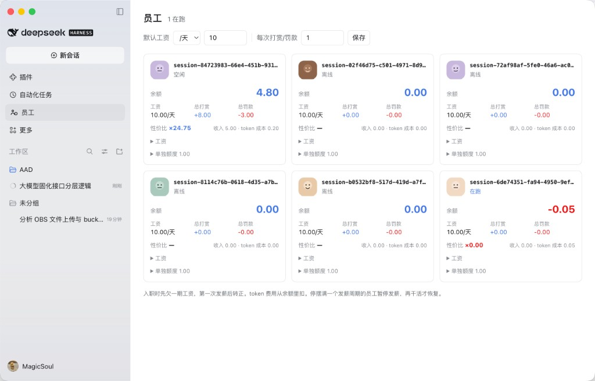

# i-am-boss-dsh

把 DeepSeek Harness 里正在跑的 agent 变成你的员工：**按日/周/月发工资，按完成质量打赏或罚款，token 费用从它自己的工资里扣。**

[](https://github.com/deepseek-ai/deepseek-harness)
[](LICENSE)

> 你给每个 agent 发工资。它烧的每一分 token 钱，都要从这份工资里扣。
>
> 入职先给一笔启动余额，干得好有打赏，干得差被罚款，越干越有钱。
>
> **于是它开始算账了。**



---

## 一句话：把"花了多少钱"变成"值不值"

平时你只能看到账单：这个 agent 今天烧了 3 块钱。但 3 块钱换来的是一个能上线的功能，还是一堆反复推翻的废代码？账单不会告诉你。

这个插件给每个 agent 开一个银行账户，让它的开销和收入落在同一栏里：

| | 记在哪 |
| --- | --- |
| 初始余额 | 入职时一次性发放，金额可配 |
| 工资 | 每过一个发薪周期，自动入账（前提是它在干活） |
| 打赏 | 你点一下，按完成质量给 |
| 罚款 | 你点一下，返工就扣 |
| **token 成本** | 每轮对话按官方牌价实时扣，含缓存命中/未命中分档和峰谷价 |

剩下的一个数字就是答案：**利润 = 收入 − token 成本**。

- `+1.80` → 它赚回来的比烧掉的多，赚的
- `−0.40` → 公司在它身上亏钱，该换思路了

---

## 最有趣的地方：它自己看得见这张工资卡

这是我认为最值的设计。每个 agent 的系统提示里都有一段自己的工资卡，随结算刷新：

```
你的工资卡：余额 8.72 元（正数是存款，负数说明花掉的比赚到的多），工资 10 元/天（全局默认）。
累计收入 0.00 元（工资 0.00 + 打赏 0.00 - 罚款 0.00），token 成本 1.28 元，利润 -1.28 元。
利润是负数：你烧掉的 token 比赚回来的多，公司在你身上亏钱。
老板每次点打赏或罚款是 1.00 元。
所以：用尽量少的 token 把活干对、干完，利润才会转正；反复试错和冗长输出都在烧你自己的钱。
```

效果是：**你不用教它省钱，它自己会省。** 少读一遍没必要的文件、别把整个日志贴进上下文、别写三轮才对，这些它以前不在乎的事，现在直接扣它的钱。

而且这不是口头威胁，是真实账本：扣的钱真的减少了余额，余额真的决定它在排行榜上的位置。

### 几个好玩的用法

- **让它自己报账**：问"你今天赚了多少？"，它会答出余额、利润和还欠多少 —— 数据来自 `boss_payroll` 工具，不是幻觉。
- **给好员工涨薪**：某个 agent 连续几次 ×3 以上，给它单独设更高的日薪，剩下的维持默认。
- **公开处刑**：排行榜按利润排名，倒数第一的卡片是红色负数。它自己查 `list` 也能看到自己排第几（但看不到别人有多少钱）。
- **停薪观察**：一个发薪周期没干活，工资自动停发，卡片标"停薪"。重新干活就恢复 —— 不用你手动管。
- **打赏当 code review**：改得好点 `+5`，跑偏了点 `-5`。不写理由，两个按钮就够。

---

## 具体能干什么

- **自动入职**：`ctx.agents.list()` 里出现的 agent 直接进名册，卡片显示按 id 生成的固定头像、状态、模型。
- **入职启动金**：新员工一次性入账「初始余额」（默认 10 元，可改），从正数起步；之后每过一个发薪周期自动入账工资（前提是它在干活）。
- **工资两级配置**：全局一套「金额 + 周期」和「单次打赏/罚款额度」，每个员工可单独覆盖，个体优先；点「用默认」退回全局。
- **打赏 / 罚款**：每条回复下方两个按钮，直接写 `+1.00` / `-1.00`，点一下生效，不填理由。
- **利润**：卡片上大字显示「收入 − token 成本」，正数蓝色、负数红色，旁边配收入与成本的明细。
- **排序**：在跑的排前面，离线的按最后活跃时间从近到远沉底，久未干活的不会挤占视线。
- **权限分明**：改工资、打赏、罚款只有你能操作。agent 的工具只有 `self`（看自己）和 `list`（只看排行榜的利润，不含他人余额），不能给自己或同事发钱。

## 计价

默认闲时牌价（元 / 百万 tokens），高峰 ×2：

| 模型 | 缓存命中 | 缓存未命中 | 输出 |
| --- | --- | --- | --- |
| `deepseek-flash` | 0.02 | 1 | 4 |
| `deepseek-v4-pro` | 0.15 | 4.5 | 13.5 |

高峰为北京时间周一至周五 9:00–12:00、14:00–18:00。法定节假日未排除，价格改在 `payroll.js` 的 `RATES`。

数据来自 Harness 的 `tokenUsage` 投影，按四类桶分别计价：未命中输入、缓存命中、缓存写出、输出。只看增量，入职前已经产生的用量不补扣。

## 安装

**从 GitHub 安装**（不需要 npm 发布）：

```
dsh plugin --profile desktop add github:walldong/i-am-boss-dsh
```

或在 Harness **Plugins** 页添加 `github:walldong/i-am-boss-dsh`。安装后重启 Harness，左侧栏出现「员工」。

**从源码**（改代码时）：

```
plugin_manager action=install_bundle target=/绝对路径/i-am-boss-dsh
```

更新：`dsh plugin --profile desktop update i-am-boss-dsh`，之后必须重启。

## 加入插件市场

DSH 没有官方市场，Discover 读的是社区索引。本仓库已打 `dsh-plugin` topic，会被 [dsh-plugin-index](https://github.com/whoishuhu/dsh-plugin-index) 次日自动收录；也可以直接添加本仓库自带的索引：

```
https://raw.githubusercontent.com/walldong/i-am-boss-dsh/main/market/index.json
```

在 Plugins → More → 开启 **Custom plugin markets** → Discover 里粘贴即可。

## 结构

| 文件 | 作用 |
| --- | --- |
| `index.js` | Host 插件：路由 `/i-am-boss/api`、30 秒结算定时器、`boss_payroll` 工具、账本读写、每 agent 的工资卡提示 |
| `payroll.js` | 纯计算：计价、增量扣费、工资入账、停薪判定 |
| `client.js` | Web UI：`sidebar.panellist` 入口 + `main` 卡片面板 + 回复下的打赏/罚款按钮 |
| `cordis.patch.yml` | bundle patch，插入 `i-am-boss` 行 |

账本在 `~/.dsh/i-am-boss-ledger.json`，原子写入（临时文件 + rename）。v1 账本自动迁移。

## 自检

```
node payroll.js && node test-host.js && node test-client.js
```

`payroll.js` 跑计价与发薪断言；`test-host.js` 用假 ctx 起 HTTP 打真实路由，验证覆盖优先级、负数开局、停薪、权限拒绝、利润算式，以及旧账本余额的修复只生效一次；`test-client.js` 用微型 React shim 渲染真实组件并断言卡片内容。

## License

MIT
